# D16nano block architecture


```xml
<svg xmlns="http://w3.org" viewBox="0 0 1050 950" width="100%" height="100%">
  <!-- Hintergrund -->
  <rect width="1050" height="950" fill="#ffffff" />
  
  <defs>
    <marker id="arrow" viewBox="0 0 10 10" refX="5" refY="5" markerWidth="6" markerHeight="6" orient="auto-start-reverse">
      <path d="M 0 1 L 10 5 L 0 9 z" fill="#333333" />
    </marker>
  </defs>

  <!-- VERBINDUNGEN -->
  <path d="M 55 130 L 55 410 L 460 410" fill="none" stroke="#333333" stroke-width="2" marker-start="url(#arrow)" />
  <path d="M 165 130 L 165 370 L 460 370" fill="none" stroke="#333333" stroke-width="2" marker-start="url(#arrow)" />
  <path d="M 360 130 L 360 310 L 490 310 L 490 330" fill="none" stroke="#333333" stroke-width="2" marker-start="url(#arrow)" marker-end="url(#arrow)" />
  <path d="M 540 130 L 540 230" fill="none" stroke="#333333" stroke-width="2" marker-start="url(#arrow)" marker-end="url(#arrow)" />
  <path d="M 740 130 L 740 160 L 610 160 L 610 250" fill="none" stroke="#333333" stroke-width="2" marker-end="url(#arrow)" />

  <path d="M 610 370 L 730 370" fill="none" stroke="#333333" stroke-width="2" marker-start="url(#arrow)" marker-end="url(#arrow)" />
  <path d="M 610 510 L 730 510" fill="none" stroke="#333333" stroke-width="2" marker-start="url(#arrow)" marker-end="url(#arrow)" />
  <path d="M 610 610 L 660 610 L 660 650 L 730 650" fill="none" stroke="#333333" stroke-width="2" marker-end="url(#arrow)" />
  <path d="M 870 650 L 930 650" fill="none" stroke="#333333" stroke-width="2" marker-start="url(#arrow)" marker-end="url(#arrow)" />

  <path d="M 160 510 L 250 510" fill="none" stroke="#333333" stroke-width="2" marker-start="url(#arrow)" marker-end="url(#arrow)" />
  <path d="M 390 510 L 460 510" fill="none" stroke="#333333" stroke-width="2" marker-start="url(#arrow)" marker-end="url(#arrow)" />
  <path d="M 160 680 L 250 680" fill="none" stroke="#333333" stroke-width="2" marker-start="url(#arrow)" marker-end="url(#arrow)" />
  <path d="M 390 680 L 440 680 L 440 590 L 460 590" fill="none" stroke="#333333" stroke-width="2" marker-start="url(#arrow)" marker-end="url(#arrow)" />

  <path d="M 500 710 L 500 770 L 390 770 L 390 830" fill="none" stroke="#333333" stroke-width="2" marker-end="url(#arrow)" />
  <path d="M 500 770 L 650 770 L 650 830" fill="none" stroke="#333333" stroke-width="2" marker-end="url(#arrow)" />
  <path d="M 430 830 L 430 800 L 580 800 L 580 830" fill="none" stroke="#333333" stroke-width="2" marker-start="url(#arrow)" marker-end="url(#arrow)" />

  <!-- BLÖCKE -->
  <rect x="10" y="10" width="90" height="120" fill="#E8EAF6" stroke="#333333" stroke-width="2" />
  <text x="55" y="65" font-family="sans-serif" font-size="14" text-anchor="middle">Boot</text>
  <text x="55" y="85" font-family="sans-serif" font-size="14" text-anchor="middle">ROM</text>

  <rect x="120" y="10" width="110" height="120" fill="#E8EAF6" stroke="#333333" stroke-width="2" />
  <text x="175" y="65" font-family="sans-serif" font-size="14" text-anchor="middle">External</text>
  <text x="175" y="85" font-family="sans-serif" font-size="14" text-anchor="middle">Flash</text>

  <rect x="260" y="10" width="200" height="120" fill="#E1BEE7" stroke="#333333" stroke-width="2" />
  <text x="360" y="75" font-family="sans-serif" font-size="16" text-anchor="middle">MEM</text>

  <rect x="490" y="10" width="100" height="120" fill="#D1C4E9" stroke="#333333" stroke-width="2" />
  <text x="540" y="75" font-family="sans-serif" font-size="16" text-anchor="middle">Cache</text>

  <rect x="700" y="10" width="80" height="120" fill="#7986CB" stroke="#333333" stroke-width="2" />
  <text x="740" y="75" font-family="sans-serif" font-size="16" text-anchor="middle" fill="#ffffff">SIC</text>

  <rect x="460" y="230" width="150" height="480" fill="#FFA726" stroke="#333333" stroke-width="2" />
  <text x="535" y="460" font-family="sans-serif" font-size="16" font-weight="bold" text-anchor="middle">Deep16</text>
  <text x="535" y="485" font-family="sans-serif" font-size="15" text-anchor="middle">3 stage core</text>

  <rect x="40" y="450" width="120" height="120" fill="#81C784" stroke="#333333" stroke-width="2" />
  <text x="100" y="515" font-family="sans-serif" font-size="15" text-anchor="middle">SD Card</text>

  <rect x="250" y="450" width="140" height="120" fill="#66BB6A" stroke="#333333" stroke-width="2" />
  <text x="320" y="505" font-family="sans-serif" font-size="15" text-anchor="middle">SPI</text>
  <text x="320" y="530" font-family="sans-serif" font-size="15" text-anchor="middle">Master</text>

  <rect x="40" y="620" width="120" height="120" fill="#81C784" stroke="#333333" stroke-width="2" />
  <text x="100" y="675" font-family="sans-serif" font-size="15" text-anchor="middle">USB-C</text>
  <text x="100" y="695" font-family="sans-serif" font-size="15" text-anchor="middle">Serial</text>

  <rect x="250" y="620" width="140" height="120" fill="#66BB6A" stroke="#333333" stroke-width="2" />
  <text x="320" y="685" font-family="sans-serif" font-size="16" text-anchor="middle">UART</text>

  <rect x="730" y="310" width="140" height="120" fill="#66BB6A" stroke="#333333" stroke-width="2" />
  <text x="800" y="375" font-family="sans-serif" font-size="16" text-anchor="middle">Timer</text>

  <rect x="730" y="450" width="140" height="120" fill="#66BB6A" stroke="#333333" stroke-width="2" />
  <text x="800" y="515" font-family="sans-serif" font-size="16" text-anchor="middle">PS/2</text>

  <rect x="730" y="590" width="140" height="120" fill="#66BB6A" stroke="#333333" stroke-width="2" />
  <text x="800" y="655" font-family="sans-serif" font-size="16" text-anchor="middle">I2S Audio</text>

  <rect x="930" y="590" width="110" height="120" fill="#81C784" stroke="#333333" stroke-width="2" />
  <text x="985" y="645" font-family="sans-serif" font-size="15" text-anchor="middle">PCM</text>
  <text x="985" y="675" font-family="sans-serif" font-size="15" text-anchor="middle">Amp</text>

  <rect x="40" y="810" width="100" height="110" fill="#B0BEC5" stroke="#333333" stroke-width="2" />
  <text x="90" y="870" font-family="sans-serif" font-size="16" text-anchor="middle">Clk</text>

  <rect x="330" y="830" width="100" height="100" fill="#E1BEE7" stroke="#333333" stroke-width="2" />
  <text x="380" y="885" font-family="sans-serif" font-size="16" text-anchor="middle">VMEM</text>

  <rect x="580" y="830" width="160" height="100" fill="#EF5350" stroke="#333333" stroke-width="2" />
  <text x="660" y="885" font-family="sans-serif" font-size="16" font-weight="bold" text-anchor="middle" fill="#ffffff">FIT Gfx</text>
</svg>
```


Logical block diagram of the **D16nano** build (`D16NANO` + `D16_PERIPH` +
`D16SEG` + `DVI_TILE` + `USER_FLASH`) on the Tang Nano 9K. It shows the
three-stage `core3` at 6.75 MHz, the shared system bus, the on-chip and external
memories, the MMIO peripherals, the FiT/DVI video path, and the board-level
interfaces. The diagram is a logical view, not a pinout.

<a href="BLOCKARCH.svg"></a>

The diagram is a pre-rendered SVG of the `block-beta` source in
[`BLOCKARCH.mmd`](BLOCKARCH.mmd). GitHub's native Mermaid renderer does not
support `block-beta`, so the SVG is embedded as an image instead. Regenerate it
from the repository root with:

```sh
npx @mermaid-js/mermaid-cli -i doc/BLOCKARCH.mmd -o doc/BLOCKARCH.svg -c doc/mermaid-config.json -b white
```

`doc/mermaid-config.json` disables HTML labels (`htmlLabels: false`) so the
labels are plain SVG `<text>` elements rather than `<foreignObject>`, which
GitHub's SVG sanitizer would strip. In a container where Chromium cannot use
its sandbox, add a Puppeteer config with `--no-sandbox` via `-p`.

## Reading the diagram

- **FPGA fabric** — the clock system, `core3`, BSRAM, boot ROM, PSRAM cache,
  MMIO peripherals, tile engine, and DVI transmitter are inside the GW1NR-9.
- **External memory** — the 64 Mbit HyperRAM and 4 MB configuration flash are
  board devices reached through the PSRAM controller and the SPI master.
- **System bus** — the dark block is the 20-bit physical-address / 16-bit data
  bus. A single read port is shared by instruction fetch and loads; a load
  preempts a fetch, and the fetch holds its address and retries. Stores use a
  separate write port. `phys = (segment << 4) + offset`.
- **Board interfaces** — the pink blocks are off-chip: USB-C for JTAG and the
  USB-UART bridge, the PS/2 and microSD sockets, HDMI and audio, and the power,
  reset, LED, and button pins.

## Clock domains

| Domain | Frequency | Used by |
|---|---:|---|
| Board oscillator | 27 MHz | PLL reference and CPU clock divider |
| CPU / system | 6.75 MHz (27 MHz ÷ 4) | `core3`, system bus, timer, UART, SPI, PS/2 |
| DVI pixel | 74.25 MHz | 1280 × 720 @ 60 Hz pixel clock |
| DVI serial | 371.25 MHz | 5× bit serializer |
| DVI render | 24.75 MHz | FiT tile engine and raster path |
| PSRAM | 51 MHz | HyperRAM controller and PHY |

The 6.75 MHz CPU clock is specific to the D16nano build; the text-console
D16MINI build runs the same RTL at 13.5 MHz.

## Memory and boot

| Region | Size | Role |
|---|---:|---|
| Boot ROM | 16 words | Reset entry and vectors at `0x0FFFF0`–`0x0FFFFF` |
| BSRAM | 26 blocks total | Boot image, PSRAM cache, UART/keyboard FIFOs, tile and sprite banks |
| HyperRAM | 1M-word CPU window (2 MB) | Boot image at `0x0000`–`0x5FFF`, dictionary from `0x6000` |
| Config flash | 4 MB | Bitstream at 0, boot image at `0x100000`, 4 KB slices at `0x200000` |

At power-on the SPI master reads the boot image from configuration flash
`0x100000`, expands it into PSRAM `0x0000`–`0x5FFF`, checks the CRC, and starts
`core3` at `0x0100`. The PSRAM cache is 512 direct-mapped lines of two words,
write-through with update on hit; the CPU-visible PSRAM window is 1M words even
though the package contains 64 Mbit.

## MMIO map

| Block | Address | Notes |
|---|---|---|
| Timer | `0xF0020`–`0xF002F` | 32-bit millisecond counter, compare, status |
| UART | `0xF0040`–`0xF004F` | 64-byte RX FIFO; one-byte TX holding register |
| Keyboard | `0xF0060`–`0xF0064` | PS/2 scan-code FIFO and echo cell |
| Display status | `0xF0066`, `0xF0068`, `0xF006A` | VBlank/frame, cycle and instruction counters |
| SPI master | `0xF0080`–`0xF008F` | Mode-0 byte master; CS0 = SD, CS1 = config flash |
| I2S | `0xF00A0`–`0xF00AF` | Audio data, control, status, FIFO |
| SIC | `0xF00B0`–`0xF00BF` | Keyboard, timer, audio, and raster interrupt sources |
| FiT tile engine | `0xF1000`–`0xF60AF` | Tilemap, palette, OAM, and sprite banks |

The D16nano `core3` does not contain a hardware divider. `DIV` and `DIV32` raise
the ILL trap (vector 0), and the kernel's handler emulates them in software.
Hardware interrupt entry is provided by the SIC; the timer block is still polled
in the current build.
