# D16nano block architecture

Logical block diagram of the **D16nano** build (`D16NANO` + `D16_PERIPH` +
`D16SEG` + `DVI_TILE` + `USER_FLASH`) on the Tang Nano 9K. It shows the
three-stage `core3` at 6.75 MHz, the shared system bus, the on-chip and external
memories, the MMIO peripherals, the FiT/DVI video path, and the board-level
interfaces. The diagram is a logical view, not a pinout.

<a href="BLOCKARCH.svg"></a>

The diagram is a pre-rendered SVG of the `block-beta` source in
[`BLOCKARCH.mmd`](BLOCKARCH.mmd). GitHub's native Mermaid renderer does not
support `block-beta`, so the SVG is embedded as an image instead. Regenerate it
from the repository root with:

```sh
npx @mermaid-js/mermaid-cli -i doc/BLOCKARCH.mmd -o doc/BLOCKARCH.svg -c doc/mermaid-config.json -b white
```

`doc/mermaid-config.json` disables HTML labels (`htmlLabels: false`) so the
labels are plain SVG `<text>` elements rather than `<foreignObject>`, which
GitHub's SVG sanitizer would strip. In a container where Chromium cannot use
its sandbox, add a Puppeteer config with `--no-sandbox` via `-p`.

## Reading the diagram

- **FPGA fabric** — the clock system, `core3`, BSRAM, boot ROM, PSRAM cache,
  MMIO peripherals, tile engine, and DVI transmitter are inside the GW1NR-9.
- **External memory** — the 64 Mbit HyperRAM and 4 MB configuration flash are
  board devices reached through the PSRAM controller and the SPI master.
- **System bus** — the dark block is the 20-bit physical-address / 16-bit data
  bus. A single read port is shared by instruction fetch and loads; a load
  preempts a fetch, and the fetch holds its address and retries. Stores use a
  separate write port. `phys = (segment << 4) + offset`.
- **Board interfaces** — the pink blocks are off-chip: USB-C for JTAG and the
  USB-UART bridge, the PS/2 and microSD sockets, HDMI and audio, and the power,
  reset, LED, and button pins.

## Clock domains

| Domain | Frequency | Used by |
|---|---:|---|
| Board oscillator | 27 MHz | PLL reference and CPU clock divider |
| CPU / system | 6.75 MHz (27 MHz ÷ 4) | `core3`, system bus, timer, UART, SPI, PS/2 |
| DVI pixel | 74.25 MHz | 1280 × 720 @ 60 Hz pixel clock |
| DVI serial | 371.25 MHz | 5× bit serializer |
| DVI render | 24.75 MHz | FiT tile engine and raster path |
| PSRAM | 51 MHz | HyperRAM controller and PHY |

The 6.75 MHz CPU clock is specific to the D16nano build; the text-console
D16MINI build runs the same RTL at 13.5 MHz.

## Memory and boot

| Region | Size | Role |
|---|---:|---|
| Boot ROM | 16 words | Reset entry and vectors at `0x0FFFF0`–`0x0FFFFF` |
| BSRAM | 26 blocks total | Boot image, PSRAM cache, UART/keyboard FIFOs, tile and sprite banks |
| HyperRAM | 1M-word CPU window (2 MB) | Boot image at `0x0000`–`0x5FFF`, dictionary from `0x6000` |
| Config flash | 4 MB | Bitstream at 0, boot image at `0x100000`, 4 KB slices at `0x200000` |

At power-on the SPI master reads the boot image from configuration flash
`0x100000`, expands it into PSRAM `0x0000`–`0x5FFF`, checks the CRC, and starts
`core3` at `0x0100`. The PSRAM cache is 512 direct-mapped lines of two words,
write-through with update on hit; the CPU-visible PSRAM window is 1M words even
though the package contains 64 Mbit.

## MMIO map

| Block | Address | Notes |
|---|---|---|
| Timer | `0xF0020`–`0xF002F` | 32-bit millisecond counter, compare, status |
| UART | `0xF0040`–`0xF004F` | 64-byte RX FIFO; one-byte TX holding register |
| Keyboard | `0xF0060`–`0xF0064` | PS/2 scan-code FIFO and echo cell |
| Display status | `0xF0066`, `0xF0068`, `0xF006A` | VBlank/frame, cycle and instruction counters |
| SPI master | `0xF0080`–`0xF008F` | Mode-0 byte master; CS0 = SD, CS1 = config flash |
| I2S | `0xF00A0`–`0xF00AF` | Audio data, control, status, FIFO |
| SIC | `0xF00B0`–`0xF00BF` | Keyboard, timer, audio, and raster interrupt sources |
| FiT tile engine | `0xF1000`–`0xF50FF` | Tilemap, palette, OAM, and sprite banks |

The D16nano `core3` does not contain a hardware divider. `DIV` and `DIV32` raise
the ILL trap (vector 0), and the kernel's handler emulates them in software.
Hardware interrupt entry is provided by the SIC; the timer block is still polled
in the current build.
